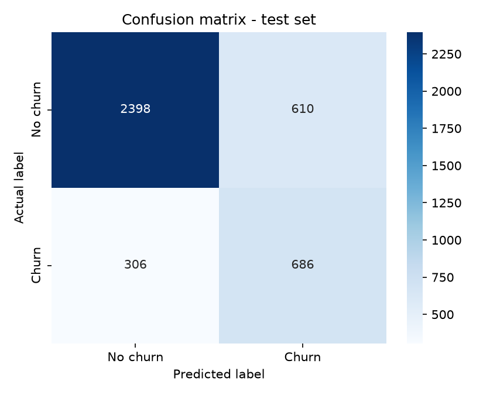
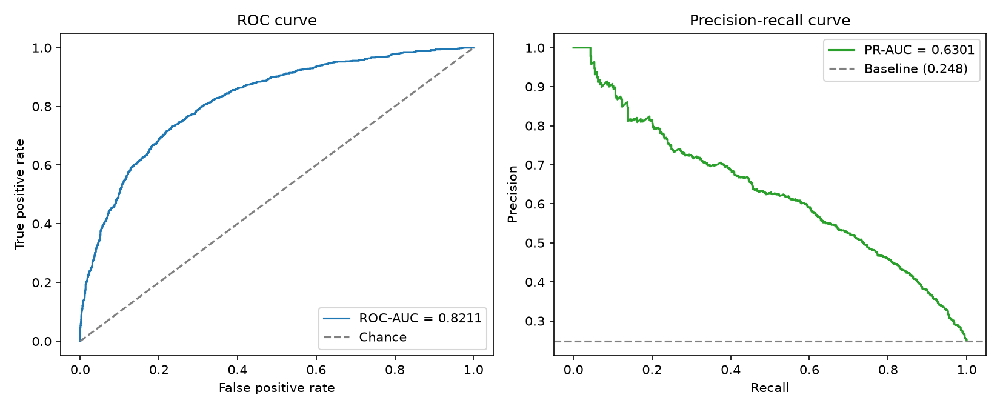
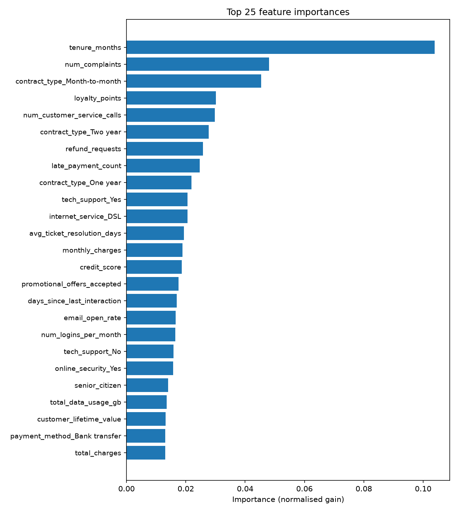
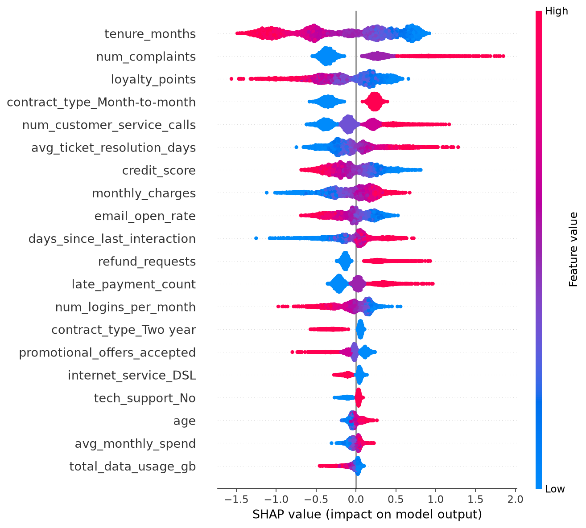

# Customer Churn Prediction - Model Report

> Generated by `churn_poc.py` using **scikit-learn** and **XGBoost**.

Binary target: `churn` (1 = customer churns in the upcoming year, 0 = stays).

## 1. Dataset

- Rows: **20,000**
- Features: **41** (26 numeric, 15 categorical)
- Overall churn rate: **24.80%**
- Train / test split: **80% / 20%** (stratified)
- Cross-validation: **5-fold** stratified on the training split

## 2. Model

| Parameter | Value |
|---|---:|
| Algorithm | XGBClassifier |
| n_estimators | 600 |
| learning_rate | 0.05 |
| max_depth | 6 |
| min_child_weight | 2 |
| subsample | 0.85 |
| colsample_bytree | 0.85 |
| reg_lambda | 1.0 |
| scale_pos_weight | 3.0333 |
| early_stopping_rounds | 50 |
| best_iteration | 161 |
| best validation ROC-AUC | 0.8317 |

## 3. Held-out test set performance

| Metric | Score |
|---|---:|
| F1 score (churn class) | 0.5997 |
| Precision (churn class) | 0.5293 |
| Recall / sensitivity (churn class) | 0.6915 |
| Accuracy | 0.7710 |
| Balanced accuracy | 0.7444 |
| ROC-AUC | 0.8211 |
| PR-AUC (average precision) | 0.6301 |
| Log loss | 0.4732 |
| Brier score | 0.1554 |
| Matthews correlation coefficient | 0.4510 |
| Cohen's kappa | 0.4432 |
| D2 deviance R^2 (classification R^2 analogue) | 0.1552 |
| McFadden pseudo-R^2 | 0.1552 |

## 4. Cross-validated performance (training split)

| Metric | Mean | Std. dev. |
|---|---:|---:|
| F1 score | 0.5855 | 0.0118 |
| Precision | 0.5641 | 0.0182 |
| Recall | 0.6090 | 0.0098 |
| Accuracy | 0.7861 | 0.0088 |
| Balanced accuracy | 0.7268 | 0.0076 |
| ROC-AUC | 0.8211 | 0.0093 |
| PR-AUC | 0.6146 | 0.0149 |
| Log loss (negated) | -0.4554 | 0.0141 |
| Matthews correlation coefficient | 0.4424 | 0.0177 |

## 5. Confusion matrix (test set)

|  | Predicted: no churn | Predicted: churn |
|---|---:|---:|
| **Actual: no churn** | 2,398 (TN) | 610 (FP) |
| **Actual: churn** | 306 (FN) | 686 (TP) |

## 6. Per-class classification report

```text
              precision    recall  f1-score   support

    No churn     0.8868    0.7972    0.8396      3008
       Churn     0.5293    0.6915    0.5997       992

    accuracy                         0.7710      4000
   macro avg     0.7081    0.7444    0.7196      4000
weighted avg     0.7982    0.7710    0.7801      4000
```

## 7. Top feature importances

| Rank | Feature | Importance |
|---:|---|---:|
| 1 | `tenure_months` | 0.1038 |
| 2 | `num_complaints` | 0.0480 |
| 3 | `contract_type_Month-to-month` | 0.0454 |
| 4 | `loyalty_points` | 0.0301 |
| 5 | `num_customer_service_calls` | 0.0298 |
| 6 | `contract_type_Two year` | 0.0277 |
| 7 | `refund_requests` | 0.0258 |
| 8 | `late_payment_count` | 0.0247 |
| 9 | `contract_type_One year` | 0.0219 |
| 10 | `tech_support_Yes` | 0.0206 |
| 11 | `internet_service_DSL` | 0.0206 |
| 12 | `avg_ticket_resolution_days` | 0.0193 |
| 13 | `monthly_charges` | 0.0189 |
| 14 | `credit_score` | 0.0186 |
| 15 | `promotional_offers_accepted` | 0.0175 |
| 16 | `days_since_last_interaction` | 0.0169 |
| 17 | `email_open_rate` | 0.0165 |
| 18 | `num_logins_per_month` | 0.0164 |
| 19 | `tech_support_No` | 0.0159 |
| 20 | `online_security_Yes` | 0.0158 |
| 21 | `senior_citizen` | 0.0141 |
| 22 | `total_data_usage_gb` | 0.0136 |
| 23 | `customer_lifetime_value` | 0.0132 |
| 24 | `payment_method_Bank transfer` | 0.0131 |
| 25 | `total_charges` | 0.0131 |

## 8. Plots

### Confusion matrix



### ROC and precision-recall curves



### Top 25 feature importances



### SHAP summary (test set)



## 9. A note on R^2

R^2 (the coefficient of determination) is defined for **continuous regression** targets. Churn is a **binary classification** problem, so a plain R^2 is not a valid measure here. The closest classification equivalents are reported above:

- **D2 deviance R^2** - `1 - log_loss(model) / log_loss(null model)`. 1.0 is a perfect model, 0.0 is no better than always predicting the base rate, negative values are worse than the base rate.
- **McFadden pseudo-R^2** - a likelihood-ratio analogue of R^2.

## 10. Key takeaways

- The model reaches an F1 of **0.5997**, precision of **0.5293** and recall of **0.6915** on the held-out test set.
- ROC-AUC of **0.8211** indicates strong ranking ability.
- `scale_pos_weight` compensates for class imbalance; for production, tune the decision threshold against the business cost of false positives vs. false negatives.
- SHAP values (if available) explain *why* each customer is scored as high risk, which is essential for retention teams.
